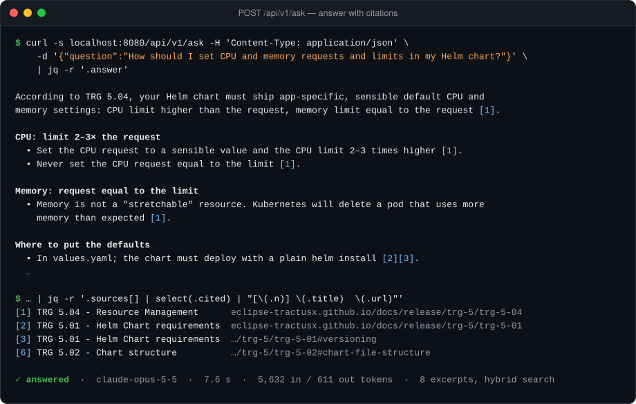
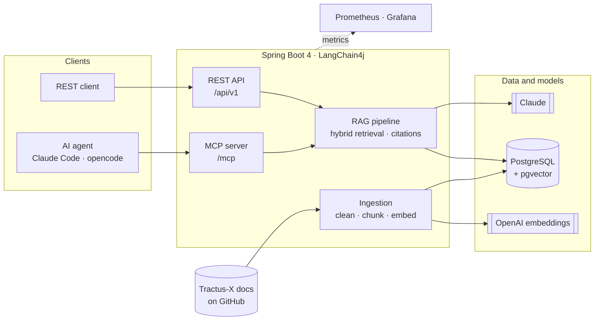
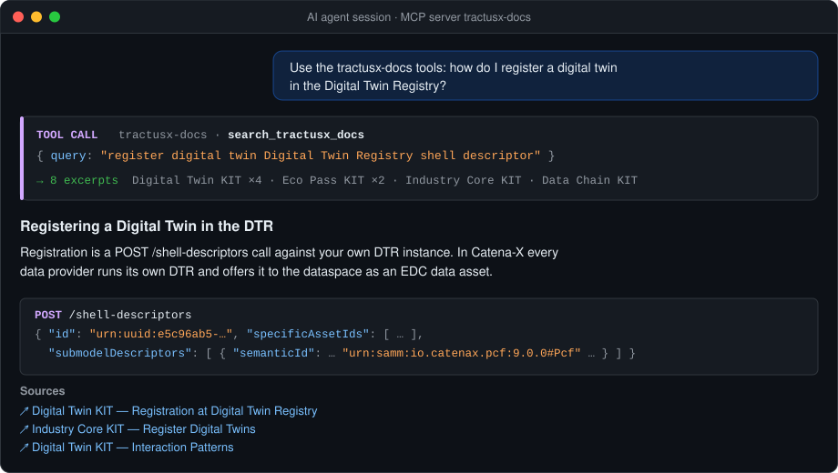
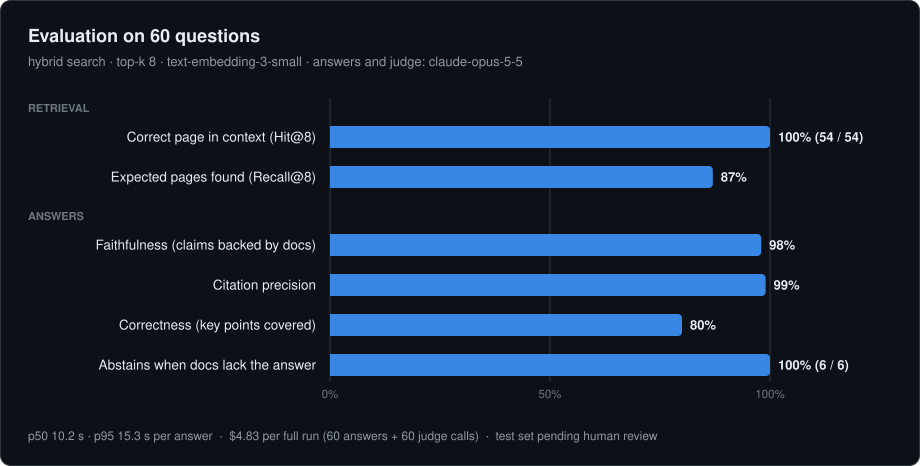
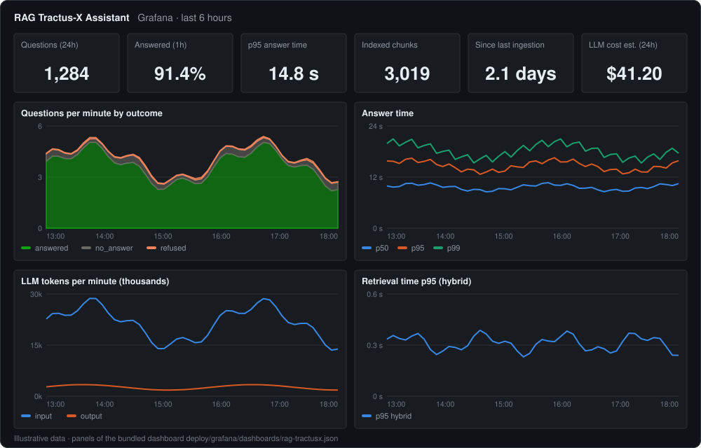

<div align="center">

# Tractus-X Docs Assistant

**Ask the Eclipse Tractus-X documentation anything, and get answers with sources.**<br/>
A RAG service in Java with an MCP server, so AI agents can use the docs as a tool.

[](https://github.com/artamrj/rag-tractus-x/actions/workflows/ci.yml)


[](LICENSE)



</div>

## Highlights

- **Grounded answers** – Claude answers only from retrieved excerpts, cites `[n]`, and says so when the docs don't cover a question
- **Hybrid retrieval** – pgvector (HNSW) + Postgres full-text search, fused with weighted reciprocal rank fusion
- **Smart ingestion** – reads 330 pages from GitHub without cloning, re-embeds only changed files, deep-links to the exact section
- **MCP server** – three read-only tools for Claude Code, opencode and other MCP clients
- **Production setup** – Docker, Helm chart with ingestion Job/CronJob, Prometheus metrics, Grafana dashboard, CI
- **Measured quality** – 60-question test set: **100%** Hit@8, **98%** faithfulness, **80%** correctness

## Architecture



More diagrams (ingestion, request flow, data model) and design decisions: [docs/architecture.md](docs/architecture.md).

## Quick start

```bash
cp .env.example .env                    # add ANTHROPIC_API_KEY and OPENAI_API_KEY
docker compose up -d --build            # app, PostgreSQL, Prometheus, Grafana
docker compose run --rm app --ingest    # index the docs (~3 min, ~$0.02)
```

```bash
curl -s -X POST localhost:8080/api/v1/ask -H 'Content-Type: application/json' \
  -d '{"question":"How do I register a digital twin in the Digital Twin Registry?"}'
```

| Endpoint | |
|---|---|
| `POST /api/v1/ask` | Answer with numbered sources, token usage and latency |
| `POST /api/v1/ask/stream` | Same, streamed as server-sent events |
| `GET /api/v1/search?q=` | Retrieval only, no LLM call |
| `/mcp` | MCP server (Streamable HTTP) |

## Use it from an AI agent

```bash
claude mcp add --transport http tractusx-docs http://localhost:8080/mcp
```



Tools: `search_tractusx_docs`, `ask_tractusx_docs`, `list_tractusx_kits`. Setup for other clients: [docs/mcp.md](docs/mcp.md).

## Quality



Method, metric definitions, the vector-vs-hybrid comparison and limitations: [docs/evaluation.md](docs/evaluation.md).

## Observability



Metrics, Helm deployment and configuration: [docs/deployment.md](docs/deployment.md).

## Documentation

| | |
|---|---|
| [Architecture](docs/architecture.md) | Components, ingestion, request flow, data model, design decisions |
| [Deployment](docs/deployment.md) | Docker Compose, Helm on Kubernetes, monitoring, configuration |
| [Evaluation](docs/evaluation.md) | Test set, metrics, results, how to run |
| [MCP server](docs/mcp.md) | Tools, client setup, troubleshooting |

## Development

```bash
./mvnw verify                  # unit + Testcontainers tests, no API keys needed
./mvnw test -Plive             # smoke test against the Claude API
```

## License

Code under [Apache-2.0](LICENSE). The indexed documentation belongs to the
[Eclipse Tractus-X](https://eclipse-tractusx.github.io) project (CC-BY-4.0); every answer links back to its source pages.
This is an independent project and is not affiliated with the Eclipse Foundation.
