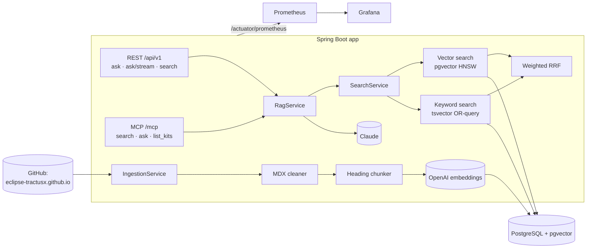

# RAG assistant for the Eclipse Tractus-X documentation

Question answering over the [Eclipse Tractus-X](https://eclipse-tractusx.github.io) docs (KITs, developer docs,
release guidelines) with Retrieval-Augmented Generation. Answers come from Claude, cite numbered sources and link to
the exact page section. The same index is exposed as an **MCP server**, so AI agents such as Claude Code can use the
docs as a tool.

- **Stack:** Java 21, Spring Boot 4.1, LangChain4j 1.23, PostgreSQL 17 + pgvector (HNSW), Claude (`claude-opus-5-5`),
  OpenAI `text-embedding-3-small` for embeddings
- **Retrieval:** heading-aware chunking, hybrid search (vector + Postgres full-text) fused with weighted reciprocal rank fusion
- **Ops:** Docker image, Helm chart (app, pgvector, ingestion Job/CronJob, ServiceMonitor, Grafana dashboard),
  Prometheus metrics, GitHub Actions CI
- **Quality:** 60-question test set with retrieval metrics (Hit@k, Recall@k, MRR) and an LLM judge
  (correctness, faithfulness, citation precision, abstention)

## Architecture



**Ingestion** reads the website repository through the GitHub API (no 3 GB clone): one call lists the tree with blob
SHAs, then only new or changed Markdown files are downloaded, cleaned (front matter, MDX imports, JSX, admonitions),
split along headings with breadcrumbs (`Connector KIT › Adoption View › Policies`), embedded and stored. Unchanged
files are skipped, deleted pages are removed, and a Postgres advisory lock keeps concurrent runs apart. It indexes the
latest *released* KIT version (`docs-kits_versioned_docs/version-<latest>/`, which is what
`eclipse-tractusx.github.io/docs-kits/...` serves) plus `docs/`, `community/` and `documentation/`: 330 pages,
about 3,000 chunks. Source URLs follow Docusaurus routing rules and were checked against the live site.

**Answering** retrieves the top chunks, puts them into the prompt as numbered `<document>` blocks, and asks Claude to
answer only from them, cite `[n]`, say so when the docs do not cover the question, and answer in the question's
language (German or English). The response lists every source with a `cited` flag, token usage and latency.

## Quick start (Docker Compose)

```bash
cp .env.example .env        # add ANTHROPIC_API_KEY and OPENAI_API_KEY
docker compose up -d --build
docker compose run --rm app --ingest
```

```bash
curl -s -XPOST localhost:8080/api/v1/ask -H 'Content-Type: application/json' \
  -d '{"question":"How do I register a digital twin in the Digital Twin Registry?"}'
```

Grafana runs on <http://localhost:3000> (admin/admin) with the dashboard preloaded, Prometheus on :9090. If the
ports are taken, set `APP_PORT` / `GRAFANA_PORT`. Without an OpenAI key, `EMBEDDING_PROVIDER=local` uses a small
in-process embedding model (fine for trying it out; lower retrieval quality).

## API

| Endpoint | Purpose |
|---|---|
| `POST /api/v1/ask` | `{question, kit?, topK?}` → `{answer, answered, outcome, sources[{n,title,url,kit,section,score,cited}], usage, latencyMs}` |
| `POST /api/v1/ask/stream` | Server-sent events: `sources`, then `token` deltas, then `done` (full response) or `error` |
| `GET /api/v1/search?q=&kit=&k=&mode=` | Retrieval only, no LLM call (`mode` = `vector` or `hybrid`) |
| `GET /api/v1/kits` | Indexed KITs with page and chunk counts |
| `POST /admin/ingest` | Incremental re-ingestion, requires `X-Admin-Token` |
| `/actuator/health/{liveness,readiness}`, `/actuator/prometheus` | Probes and metrics |

If `RAG_API_KEY` is set, `/api/**` and `/mcp` require the header `X-Api-Key`. `outcome` is `answered` (cited the
docs), `no_answer` (docs don't cover it), `refused` (model declined) or an HTTP error (429/503/504 for upstream
problems, as problem+json).

## MCP server

The app serves the Model Context Protocol over Streamable HTTP at `/mcp` with three read-only tools:

| Tool | What it does |
|---|---|
| `search_tractusx_docs(query, kit?, top_k?)` | Returns ranked excerpts with page URLs; costs no LLM tokens on the server |
| `ask_tractusx_docs(question, kit?)` | Grounded answer with numbered source links |
| `list_tractusx_kits()` | KIT ids usable as `kit` filter |

```bash
claude mcp add --transport http tractusx-docs http://localhost:8080/mcp
# with an API key:
claude mcp add --transport http tractusx-docs http://localhost:8080/mcp --header "X-Api-Key: <key>"
```

## Kubernetes (Helm)

```bash
docker build -t rag-tractusx:local .
minikube -p rag-tractusx image load rag-tractusx:local
helm install rag deploy/helm/rag-tractusx -n rag --create-namespace \
  --set secrets.anthropicApiKey=$ANTHROPIC_API_KEY --set secrets.openaiApiKey=$OPENAI_API_KEY \
  --set metrics.serviceMonitor.enabled=true --set metrics.grafanaDashboard.enabled=true
```

The chart deploys the app (startup/liveness/readiness probes, non-root, read-only root filesystem), a pgvector
StatefulSet (or `externalDatabase.*`), an ingestion Job as post-install/upgrade hook plus a weekly CronJob, and
optionally Ingress, HPA, a `ServiceMonitor` and the Grafana dashboard ConfigMap for kube-prometheus-stack. Secrets
can come from `secrets.existingSecret`. See [values.yaml](deploy/helm/rag-tractusx/values.yaml). Verified on minikube
with kube-prometheus-stack (target up, dashboard auto-imported).

## Monitoring

| Metric | Meaning |
|---|---|
| `rag_ask_duration_seconds{outcome,stream,channel}` | End-to-end answer time (histogram) by outcome |
| `rag_retrieval_duration_seconds{mode}`, `rag_retrieval_top_score` | Retrieval latency and best-match similarity |
| `rag_llm_tokens_total{model,type}`, `rag_llm_errors_total{type}` | Claude token usage and upstream errors |
| `rag_index_chunks`, `rag_ingestion_last_success_timestamp_seconds`, `rag_ingestion_last_run_files{change}` | Index size and freshness, read from the database so they are correct even though ingestion runs in a Job pod |
| `rag_mcp_tool_calls_total{tool,result}` | MCP usage |

The Grafana dashboard ([deploy/grafana](deploy/grafana/dashboards/rag-tractusx.json), generated by
`scripts/build_grafana_dashboard.py`) shows questions by outcome, p50/p95/p99 answer time, tokens and an estimated
cost, retrieval latency and similarity, errors, MCP calls and ingestion freshness.

## Evaluation

[`eval/testset.yaml`](eval/testset.yaml) holds 60 questions drafted from the docs: 32 factual, 14 procedural,
8 cross-KIT, 6 the docs cannot answer (to test abstention), 5 of them in German. Each answerable item lists the pages
that contain the answer and 2–4 key points.

```bash
# retrieval only: no Claude calls
java -jar target/rag-tractusx.jar --eval --eval.retrieval-only --eval.configs=vector:6,hybrid:6,hybrid:10
# full run: answers + LLM judge (about $4-5 per configuration with claude-opus-5-5)
java -jar target/rag-tractusx.jar --eval --eval.configs=hybrid:8
```

- **Retrieval** (deterministic): Hit@1/3/k, Recall@k and MRR at page level.
- **Answers** (LLM judge with a fixed rubric; the judge only counts, scores are computed in code): correctness
  (share of key points covered), faithfulness (share of claims supported by the retrieved excerpts), citation
  precision, abstention on unanswerable questions and false abstentions on answerable ones, latency, cost.

Reports go to `eval/reports/<timestamp>/` (Markdown summary + JSON per configuration). A free retrieval benchmark
also runs as the manually triggered GitHub Actions workflow *Retrieval eval*.

Baseline with the **local MiniLM embedding model** (retrieval only, test set not yet human-reviewed):

| Config | Hit@1 | Hit@3 | Hit@k | Recall@k | MRR |
|---|---|---|---|---|---|
| vector-k6 | 61% | 76% | 85% | 72% | 0.70 |
| hybrid-k6 | 57% | 80% | 83% | 69% | 0.69 |
| vector-k10 | 61% | 76% | 93% | 78% | 0.71 |
| hybrid-k10 | 57% | 80% | 93% | 79% | 0.70 |

With this small model, hybrid search only helps Hit@3; the OpenAI-embedding and full answer-quality numbers will be
added after the test set review.

## Development

```bash
docker compose up -d postgres
./mvnw verify                       # unit + Testcontainers integration tests, no API keys needed
./mvnw test -Plive                  # calls Claude (needs ANTHROPIC_API_KEY)
./mvnw test -Pmanual -Dtest=CorpusPreviewManualTest   # downloads the real docs, writes target/corpus-preview.md
```

Configuration lives under `rag.*` in [application.yml](src/main/resources/application.yml); the most common settings
are environment variables (`ANTHROPIC_MODEL`, `ANTHROPIC_EFFORT`, `EMBEDDING_PROVIDER`, `DOCS_REF`,
`DOCS_KITS_VERSION`, `RETRIEVAL_MODE`, `RETRIEVAL_TOP_K`, `RETRIEVAL_KEYWORD_WEIGHT`, `RAG_API_KEY`, `ADMIN_TOKEN`).

```
src/main/java/de/ragtractusx/
  ingest/     GitHub/local sources, MDX cleaner, heading chunker, Docusaurus URL mapper, incremental ingestion
  retrieval/  vector + keyword retrievers, weighted RRF, search service
  rag/        prompt builder, RAG pipeline (blocking + streaming)
  api/        REST controllers, API-key filter, error mapping
  mcp/        MCP tools
  metrics/    Micrometer meters, token listener, database-backed gauges
  eval/       test-set loader, retrieval scores, LLM judge, runner and report
deploy/       Helm chart, Grafana dashboard, Prometheus config
eval/         test set and reports
```

## License and attribution

Code: Apache-2.0. The indexed documentation belongs to the Eclipse Tractus-X project and is licensed under
CC-BY-4.0; every answer links back to the source pages.
