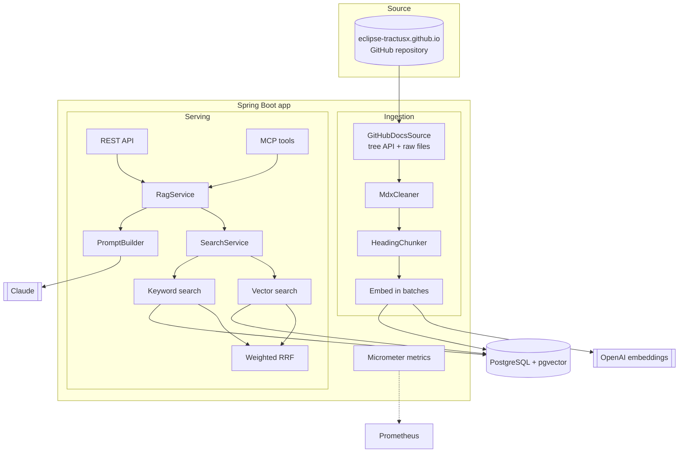
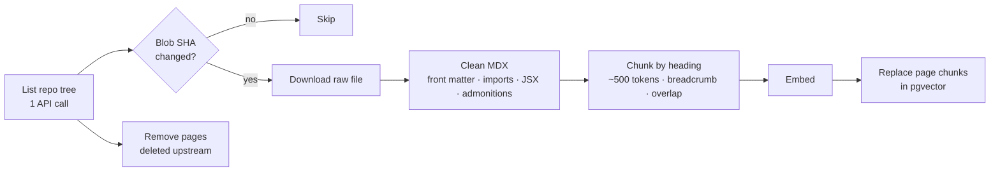
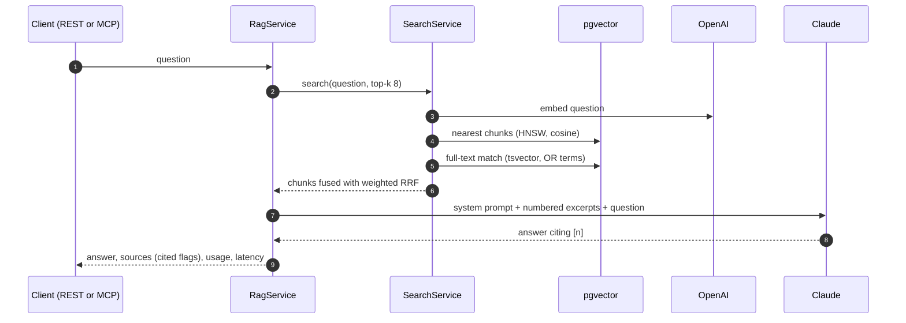
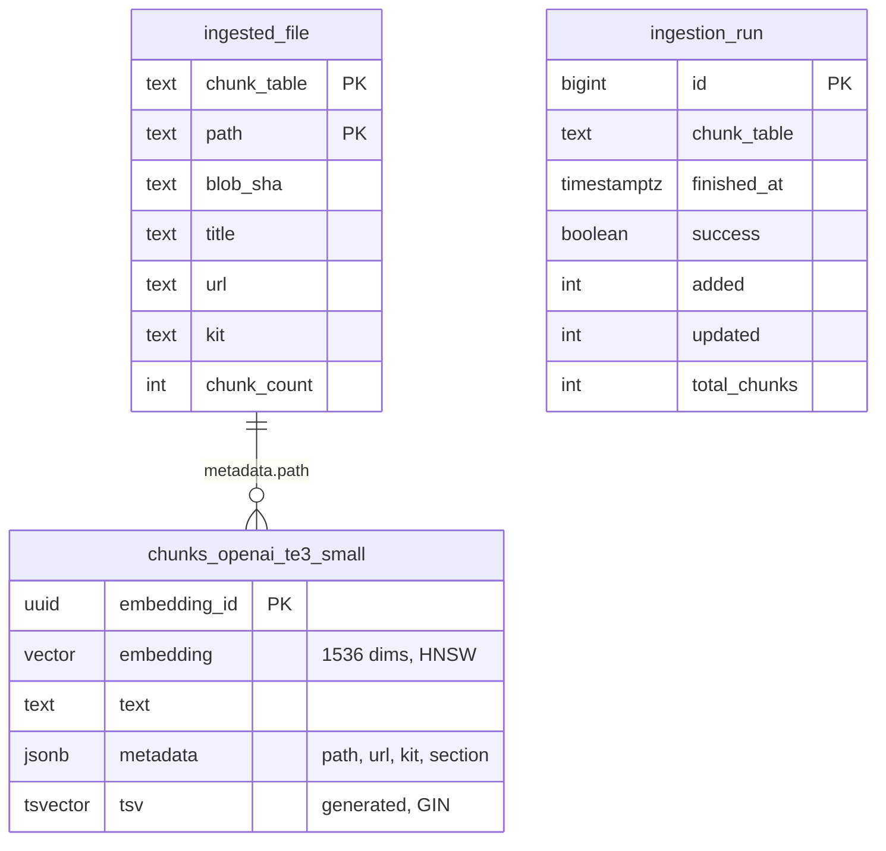

# Architecture

One Spring Boot application serves the REST API and the MCP server and runs ingestion. It stores everything in
PostgreSQL with pgvector.

## Components



## Ingestion



- **What gets indexed:** the latest *released* KIT version (`docs-kits_versioned_docs/version-<latest>/`, which is what
  `/docs-kits/...` serves), plus `docs/`, `community/` and `documentation/`. That is 330 pages and about 3,000 chunks
  across 36 KITs.
- **Incremental:** files with the same git blob SHA are skipped; a Postgres advisory lock keeps runs from overlapping.
- **Deep links:** repo paths are mapped to the published URL using Docusaurus routing rules (number prefixes,
  front-matter `id`/`slug`, folder index pages), plus heading anchors. The mapping was checked against the live site.
- **Triggers:** `java -jar app.jar --ingest` (Kubernetes Job/CronJob) or `POST /admin/ingest`.

## Answering a question



The system prompt is static (cache-friendly) and tells the model to answer only from the excerpts, cite `[n]`, say
so when the docs don't cover the question, and answer in the question's language. An answer without citations
counts as `no_answer`; a refusal returns `refused`.

## Data model



Each embedding model writes to its own chunk table, so switching models never mixes vector sizes.

## Design decisions

| Decision | Why |
|---|---|
| Read GitHub via API, no clone | The website repo is ~3 GB of images; the Markdown is a few MB |
| Index the released KIT version | `docs-kits/` is the unreleased "next" version; readers see the release |
| Own keyword search instead of LangChain4j's hybrid mode | The built-in mode needs *every* word to match, which fails for natural-language questions, and only supports IVFFlat |
| Weighted RRF (keyword weight 0.5) | Rank-based fusion needs no score calibration; measured on the test set |
| Breadcrumbs in every chunk | Short sections keep their KIT/page context in the embedding and the prompt |
| Ingestion history in the database | Ingestion runs in a Job pod that Prometheus never scrapes; app pods report freshness |
| One app for REST, MCP and ingestion | One image, one config, one set of metrics |

## Code layout

```
src/main/java/de/ragtractusx/
  ingest/     sources, MDX cleaner, chunker, URL mapper, incremental ingestion
  retrieval/  vector + keyword retrievers, weighted RRF, search service
  rag/        prompt builder, RAG pipeline (blocking + streaming)
  api/        REST controllers, API-key filter, error mapping
  mcp/        MCP tools
  metrics/    meters, token listener, database-backed gauges
  eval/       test-set loader, retrieval scores, LLM judge, runner, report
```
