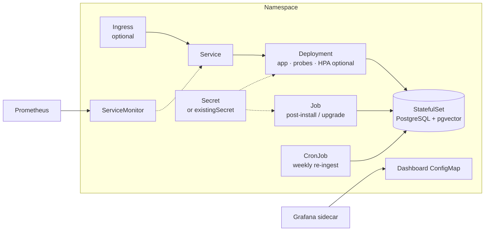

# Deployment and operations

## Docker Compose

```bash
cp .env.example .env              # ANTHROPIC_API_KEY, OPENAI_API_KEY
docker compose up -d --build
docker compose run --rm app --ingest
```

| Service | URL |
|---|---|
| App (REST + MCP) | <http://localhost:8080> |
| Grafana (admin/admin, dashboard preloaded) | <http://localhost:3000> |
| Prometheus | <http://localhost:9090> |

Ports are configurable with `APP_PORT` and `GRAFANA_PORT`.

## Run modes

Claude is only needed to *write* answers. Search, the MCP search tool, ingestion and metrics work without it.

| Mode | Keys in `.env` | What works | Retrieval (Hit@8) |
|---|---|---|---|
| **Full** | `ANTHROPIC_API_KEY`, `OPENAI_API_KEY` | Everything, including `/api/v1/ask` and `ask_tractusx_docs` | 100% |
| **Search only** | `OPENAI_API_KEY` | `/api/v1/search`, MCP `search_tractusx_docs` and `list_tractusx_kits` | 100% |
| **Fully offline** | none | Same as search only, with an in-process embedding model (all-MiniLM-L6-v2) | 87% |

Without a Claude key, `/api/v1/ask` returns `503` and `ask_tractusx_docs` returns a tool error. With MCP this still
works well: the agent calls `search_tractusx_docs` and its own model writes the answer.

**Fully offline:**

```bash
EMBEDDING_PROVIDER=local docker compose up -d
EMBEDDING_PROVIDER=local docker compose run --rm app --ingest
curl -s 'localhost:8080/api/v1/search?q=How+should+I+set+CPU+limits+in+my+Helm+chart&k=3'
```

Ingest with the same `EMBEDDING_PROVIDER` the app uses: each embedding model has its own index table, so switching
the provider needs one ingestion run for that model.

## Kubernetes with Helm



```bash
docker build -t rag-tractusx:local .
minikube image load rag-tractusx:local
helm install rag deploy/helm/rag-tractusx -n rag --create-namespace \
  --set secrets.anthropicApiKey=$ANTHROPIC_API_KEY \
  --set secrets.openaiApiKey=$OPENAI_API_KEY \
  --set metrics.serviceMonitor.enabled=true \
  --set metrics.grafanaDashboard.enabled=true
```

| Value | Default | Purpose |
|---|---|---|
| `config.anthropicModel` | `claude-opus-5-5` | Answer model |
| `config.embeddingProvider` | `openai` | `openai` or `local` |
| `config.retrievalMode` / `retrievalTopK` | `hybrid` / `8` | Retrieval settings |
| `secrets.existingSecret` | – | Use your own Secret instead of chart values |
| `postgres.enabled` | `true` | Built-in pgvector; set `false` and use `externalDatabase.url` |
| `ingestion.schedule.cron` | `0 3 * * 1` | Weekly incremental re-ingestion |
| `metrics.serviceMonitor.enabled` | `false` | For kube-prometheus-stack |

Pods run as non-root with a read-only root filesystem and dropped capabilities. Verified on minikube with
kube-prometheus-stack (target up, dashboard auto-imported). All values: [values.yaml](../deploy/helm/rag-tractusx/values.yaml).

## Monitoring


| Metric | Meaning |
|---|---|
| `rag_ask_duration_seconds{outcome}` | Answer time histogram; outcome = answered, no_answer, refused, error |
| `rag_retrieval_duration_seconds{mode}`, `rag_retrieval_top_score` | Retrieval latency and best-match similarity |
| `rag_llm_tokens_total{model,type}`, `rag_llm_errors_total` | Claude token usage and upstream errors |
| `rag_index_chunks`, `rag_ingestion_last_success_timestamp_seconds` | Index size and freshness (read from the database) |
| `rag_mcp_tool_calls_total{tool,result}` | MCP usage |

The dashboard JSON is generated by `scripts/build_grafana_dashboard.py`.

## Configuration

| Variable | Default | |
|---|---|---|
| `ANTHROPIC_API_KEY`, `OPENAI_API_KEY` | – | Required for answers / embeddings |
| `ANTHROPIC_MODEL`, `ANTHROPIC_EFFORT` | `claude-opus-5-5`, model default | Answer model and effort |
| `EMBEDDING_PROVIDER` | `openai` | `local` runs offline |
| `DOCS_REF`, `DOCS_KITS_VERSION` | `main`, `latest` | Which docs to index |
| `RETRIEVAL_MODE`, `RETRIEVAL_TOP_K`, `RETRIEVAL_KEYWORD_WEIGHT` | `hybrid`, `8`, `0.5` | Retrieval tuning |
| `RAG_API_KEY` | – | If set, `/api/**` and `/mcp` need `X-Api-Key` |
| `ADMIN_TOKEN` | – | Enables `/admin/**` with `X-Admin-Token` |
| `DB_URL`, `DB_USER`, `DB_PASSWORD` | local compose DB | PostgreSQL connection |

All settings live under `rag.*` in [application.yml](../src/main/resources/application.yml).
