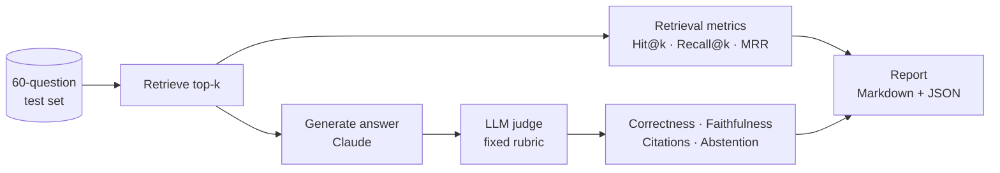

# Evaluation


## Method



**Test set** ([eval/testset.yaml](../eval/testset.yaml)), drafted from the 26.09 docs, each answer checked against the
page text:

| Category | Items |
|---|---|
| Factual | 32 |
| Procedural (how-to) | 14 |
| Cross-KIT (needs 2+ pages) | 8 |
| Unanswerable (docs don't cover it) | 6 |
| … of which in German | 5 |

**Metrics.** Retrieval is scored at page level without an LLM. For answers, the judge only *counts* (covered key
points, supported claims, valid citations, abstentions); the scores are computed in code so the rubric stays transparent.

| Metric | Definition |
|---|---|
| Hit@k | A chunk from an expected page is among the k excerpts |
| Recall@k | Share of expected pages found |
| Correctness | Share of the reference key points the answer covers |
| Faithfulness | Share of the answer's claims supported by the excerpts |
| Citation precision | Share of `[n]` markers that point to a supporting excerpt |
| Abstention | The answer says "not in the docs" when the docs really don't cover it |

## Results (2026-10-29)

Default configuration: hybrid search, top-k 8, `text-embedding-3-small`, answers and judge by `claude-opus-5-5`.

| Hit@8 | Recall@8 | Correctness | Faithfulness | Citations | Abstention | p50 / p95 | Cost per run |
|---|---|---|---|---|---|---|---|
| **100%** | 87% | 80% | **98%** | 99% | 6 / 6 | 10.2 s / 15.3 s | $4.83 |

Retrieval comparison (no LLM calls):

| Config | Hit@1 | Hit@3 | Hit@k | Recall@k | MRR |
|---|---|---|---|---|---|
| vector, k=6 | 80% | 93% | 96% | 82% | 0.87 |
| hybrid, k=6 | 74% | 93% | 98% | 84% | 0.84 |
| vector, k=8 | 80% | 93% | 96% | 84% | 0.87 |
| **hybrid, k=8 (default)** | 74% | 93% | **100%** | **87%** | 0.84 |
| hybrid, k=10 | 74% | 93% | 100% | 89% | 0.84 |

Vector search ranks the best page first more often; hybrid search gets a relevant page into the context for every
question, which matters more because the model reads all k excerpts.

**What the numbers say.** The model rarely states anything the docs don't support. Misses are mostly *incomplete*
answers: correctness is 84% for factual, 81% for cross-KIT and 70% for procedural questions, whose steps are spread
over several sections.

**Limitations.** The test set is not human-reviewed yet (`reviewed: false` on every item). Only the docs website is
indexed; product repositories (e.g. connector or DTR READMEs) are not.

## Run it

```bash
# retrieval only (no Claude calls)
java -jar target/rag-tractusx.jar --eval --eval.retrieval-only --eval.configs=vector:8,hybrid:8
# answers + judge on the default config
java -jar target/rag-tractusx.jar --eval
```

Reports are written to `eval/reports/<timestamp>/`. A free retrieval benchmark also runs as the manual GitHub Actions
workflow *Retrieval eval*.
